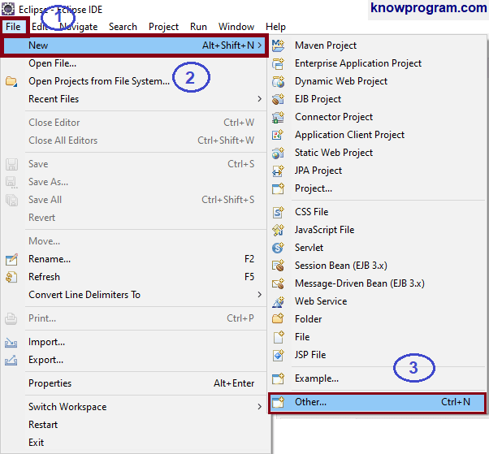
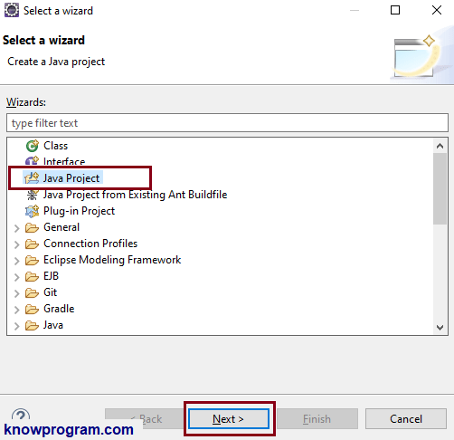
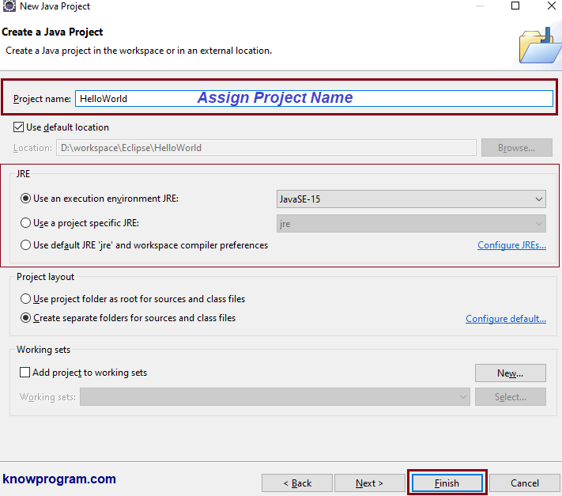
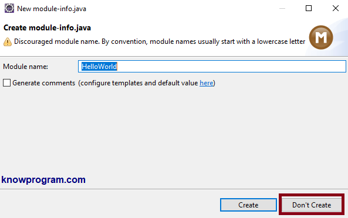
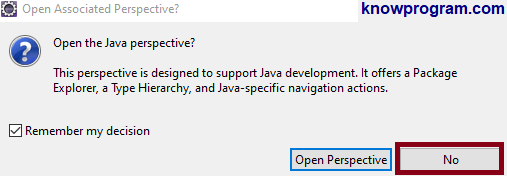

# Create Java Project in Eclipse IDE

**Create Java Project in Eclipse IDE** | Step-by-step guide to creating a new Java project in Eclipse IDE, from launching the IDE to configuring project settings.

- [Steps to Create Java Project](#steps-to-create-java-project)
- [Project Structure Overview](#project-structure-overview)

---

## 1. Steps to Create Java Project

To create a Java project in Eclipse IDE, first, start the Eclipse IDE by double-clicking on the icon. Now, launch the Eclipse IDE by choosing the workspace folder.

1️⃣ **Go to File => New => Other**

*Go to File => New => Other*

After selecting Other a wizard window will appear, which contains templates for different types of projects like Java project, Gradle project, Maven Project, Java EE project, etc.

2️⃣ **Select Java Project in the wizard window and click on Next.** If it is not appearing then search "Java Project" and then select it.

*Select Java Project => Next*

3️⃣ **Assign Project name.**

In the JRE section, it is displaying the execution environment. If you want to choose a different Java version then choose from here, else leave it as it is.

*Assign Project name*

4️⃣ **Click on Finish.**

Now, the Java project is ready and you can start developing the Java program. Based on the different Eclipse IDE editions you may get two more things:

- 📄 It may ask to **Create module-info.java** -- it is optional and currently, we don't need it. Select **Don't Create**.

- 🖥️ Next, it may ask to **Open the Java perspective** which is designed to support Java development and offers a Package Explorer, a Type Hierarchy, and Java-specific navigation actions. But we don't need them, select **No**.

> 💡 **Tip:** The Java perspective provides specialized views for Java development. You can always switch to it later from **Window** => **Perspective** => **Open Perspective** => **Java**.

---

## 2. Project Structure Overview

In the Project Explorer section, you can see the Java project. Our Java project name is "HelloWorld":

- 📦 The **JRE System Library** folder contains packages required to run Java programs.
- 📂 The **src** folder will contain the Java programs written by us.

To develop a Java program:

1. Select the **src** folder
2. Click on **New** (Shortcut **CTRL + N**)
3. Select the class/interface/enum based on your requirement and start developing the program

> 📝 **Note:** After developing the Java program, you need to compile and run it. Also see: How to compile and run Java program in Eclipse IDE.
