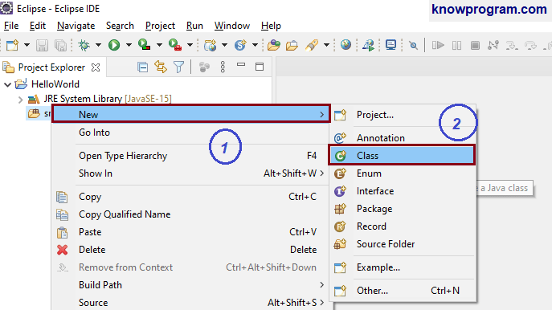
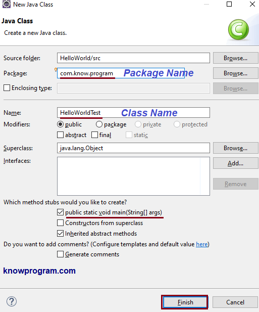
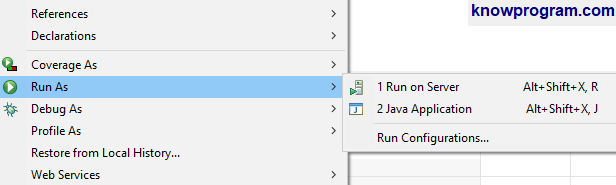
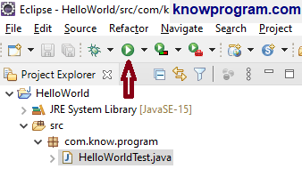

# How to Run Java Program in Eclipse IDE

**How to Run Java Program in Eclipse IDE** | Developing, compiling, and running a Java Hello World program inside Eclipse IDE.

- [Create Java Class](#create-java-class)
- [Develop Java Program](#develop-java-program)
- [Compile the Java Program in Eclipse](#compile-the-java-program-in-eclipse)
- [Run the Java Program in Eclipse](#run-the-java-program-in-eclipse)
- [Another Ways to Run Java Program in Eclipse IDE](#another-ways-to-run-java-program-in-eclipse-ide)

---

## 1. Create Java Class

Previously, we had seen [how to create a Java project in Eclipse IDE](227_Create_Java_Project_in_Eclipse_IDE.md) to develop the Java program. Now in this post, we will see how to compile and run a Java program in Eclipse IDE. Here we will develop [Java Hello World! Program](007_Java_Hello_World_Program.md) in Eclipse IDE and then we will run it inside the Eclipse IDE.

After creating the Java project, select the **src** folder, right-click on it => **New** => **Class**.


*Create Java Class*

Now, a new window will appear to create the Java class. Here assign the package name, but it is optional and if we don't assign a package name then we won't get any error, but it is recommended to assign a meaningful package name. Here we will assign package name = `com.know.program`

After assigning the package name, assign the name of the Class. Since we are developing the Java Hello World program therefore we have chosen `HelloWorldTest` as the class name.


*Assign package name and class name*

Directly or indirectly `java.lang.Object` class is the superclass for every Java class. If you are developing some other Java program that needs any interface then you can add them from here or later we can add it while developing the Java program.

Since it is a HelloWorld program that needs the `main` method, therefore, select the main method. Finally, click on the **Finish** button.

---

## 2. Develop Java Program

**Java code to display Hello World!:**

```java
package com.know.program;

public class HelloWorldTest {

  public static void main(String[] args) {
    System.out.println("Hello World!");
  }

}
```

After writing the code, save it using the shortcut **CTRL + S**.

---

## 3. Compile the Java Program in Eclipse

In Eclipse IDE no need to compile the Java program manually. Whenever Eclipse saves the Java program, it also compiles the program automatically. If there is an error in the program, then the red icon will come across that particular line, and without solving it we can't run the program.

> 💡 **Tip:** Eclipse uses an **incremental compiler** that compiles your code every time you save. Therefore no need to run a separate compile step -- directly run it.

---

## 4. Run the Java Program in Eclipse

To run the Java program in Eclipse, select the Java program which contains the `main` method, right-click on it, **Run As** => **Java Application**. The output will be displayed to the console window of the Eclipse IDE.


*Run Java Program in Eclipse IDE*

📤 **Output:**

```
Hello World!
```

> 📝 **Note:** A Java project can contain multiple Java classes and interfaces, but we can run only those classes which contain the `main` method. The class which contains the `main` method is normally called the **driver class** or **user class**.

---

## 5. Another Ways to Run Java Program in Eclipse IDE

There are additional ways to run a Java program in Eclipse IDE:

- ⌨️ **Shortcut (CTRL + F11):** Open the Java program which contains the `main` method, and use shortcut key **CTRL + F11** to run the Java program.

- ▶️ **Play Button:** At the header section of Eclipse IDE, there are many buttons for different purposes. There you can find a button having an icon like a **play** button. Open the Java program which contains the `main` method, then click on the button.



- 🖥️ **Run Menu:** In the header section of Eclipse IDE we can find the **Run** option. Select **Run** => **Run As** => **Java Application**.

| Method 🏷️ | How To 📋 | Speed ⚡ |
|-----------|----------|---------|
| **Right-click** | Right-click => Run As => Java Application | Standard |
| **Shortcut** | `CTRL + F11` | ⚡ Fastest |
| **Play Button** | Click play icon in toolbar | Quick |
| **Run Menu** | Run => Run As => Java Application | Standard |
